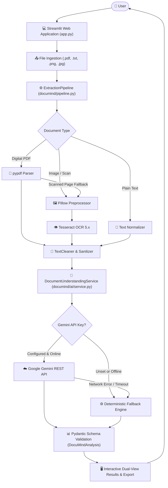

# 🧠 DocuMind-AI

> **Understand Any Document. Simplify Complex Information.**

DocuMind-AI is an intelligent, high-accessibility document understanding platform designed to deconstruct dense, complex paperwork—such as legal agreements, hospital discharge instructions, insurance policies, and financial statements—into clear, accessible plain language while strictly preserving original meaning, dates, numerical values, and critical warnings.

---

## 📌 Problem Statement

Individuals and professionals frequently face critical documents written in inaccessible, convoluted prose. Standard general-purpose AI summarizers often hallucinate facts, dangerously round off monetary penalties, omit statutory deadlines, or fail completely when handling scanned physical paperwork or mobile snapshots.

Misunderstanding such documents leads to:
- Overlooked financial obligations, late penalties, or cancellation fees.
- Critical health risks from missed medication schedules or contraindications.
- Legal vulnerabilities from ambiguous interpretations of contracts.

---

## 💡 Solution & Key Features

DocuMind-AI combines hybrid document extraction, computer vision preprocessing, and dual-mode cognitive understanding:

- **📤 Multi-Format Ingestion:** Drag-and-drop support for `.pdf`, `.txt`, `.png`, `.jpg`, `.jpeg`, `.tiff`, and `.bmp` (up to 25 MB).
- **📑 Hybrid PDF & OCR Extraction:**
  - Fast native digital text extraction via pure-Python `pypdf`.
  - Automatic scanned-page detection and OCR routing via local **Tesseract OCR 5.x**.
  - Advanced **Pillow image preprocessing** (grayscale conversion, contrast enhancement, alpha flattening, and auto-rescaling).
- **💡 Plain-English Simplification:** Translates dense clauses into 8th-grade reading level without omitting legal or medical nuance.
- **⚠️ Strict Numerical & Condition Fidelity:** Verbatim extraction of monetary figures, deadlines, percentages, penalties, and restrictive conditions (`must`, `shall`, `prohibited`).
- **📖 Jargon Buster Glossary:** Automatically pairs technical, legal, and medical terminology with plain-language explanations.
- **✅ Actionable Checklist:** Extracts concrete next steps and mandatory duties.
- **⚙️ 100% Offline Resilience:** Deterministic heuristic engine ensures the application remains functional even without an internet connection or API key.
- **📥 Dual Export Handlers:** One-click download of the complete analysis report as formatted Markdown (`.md`) or structured JSON (`.json`).

---

## 🏗️ System Architecture

DocuMind-AI adheres to a decoupled Clean Architecture pattern separating ingestion, extraction, text sanitization, cognitive understanding, and presentation:



---

## 🛠️ Technology Stack

| Component | Technology | Version | Purpose |
|---|---|---|---|
| **Runtime** | Python | 3.14.2 (Windows x64) | Primary application runtime |
| **Presentation** | Streamlit | 1.64.0 | Interactive web interface |
| **Data Validation** | Pydantic | 2.14.2 | Strict schema contracts and JSON validation |
| **Digital PDF** | pypdf | 6.19.0 | Pure-Python PDF parsing & image extraction |
| **Image Processing**| Pillow | 12.3.0 | Grayscale, contrast boost & OCR scaling |
| **OCR Engine** | Tesseract OCR | 5.4.0 (Native binary) | High-accuracy raster text recognition |
| **HTTP Client** | HTTPX | 0.28.1 | Asynchronous/Synchronous Gemini REST client |
| **AI Cognition** | Google Gemini API | v1beta | Semantic plain-English deconstruction |

---

## 📂 Project Directory Structure

```text
DocuMind-AI/
├── app.py                      # Primary Streamlit Web Application Entrypoint
├── PRD.md                      # Product Requirements Document
├── ARCHITECTURE.md             # System Architecture Documentation
├── architecture.mmd            # Mermaid Architecture Flowchart
├── TOOLS_AND_TECH_STACK.md     # Technology Stack Audit & Evaluation
├── PROJECT_PROGRESS.md         # Phase-by-Phase Progress & Regression Tracker
├── README.md                   # Complete Documentation & Usage Guide
├── .env.example                # Template Environment Secrets Configuration
├── .gitignore                  # Git Ignore Rules (.env and caches excluded)
│
├── documind/                   # Core Application Package
│   ├── __init__.py
│   ├── config.py               # Central Settings & Binary Discovery
│   ├── models.py               # Pydantic Data Contracts & Schemas
│   ├── pipeline.py             # Document Ingestion & Extraction Orchestrator
│   │
│   ├── extractors/             # Extraction Subsystem
│   │   ├── __init__.py
│   │   ├── base.py             # BaseExtractor Abstract Class
│   │   ├── pdf_extractor.py    # Hybrid pypdf Digital & Scanned PDF Extractor
│   │   ├── ocr_extractor.py    # Tesseract OCR Wrapper with Timeout Handling
│   │   └── text_extractor.py   # Multi-Encoding Plain Text Reader
│   │
│   ├── preprocessor/           # Preprocessing Subsystem
│   │   ├── __init__.py
│   │   ├── image_cleaner.py    # Pillow Contrast, Grayscale & Binarization
│   │   └── text_cleaner.py     # Whitespace, Line-Break & Hyphenation Cleaner
│   │
│   └── ai/                     # Cognitive Understanding Subsystem
│       ├── __init__.py
│       ├── prompts.py          # Cognitive Prompts & System Instructions
│       ├── llm_client.py       # Gemini API REST Client with Error Handling
│       ├── fallback_engine.py  # Deterministic Heuristic Offline Parser
│       └── service.py          # Unified Understanding Service with Failover
│
├── samples/                    # Built-in Evaluation Fixtures
│   ├── sample_contract.txt     # Commercial Office Lease Agreement
│   ├── sample_discharge_summary.txt # Hospital Discharge & Medication Directives
│   └── sample_receipt.png      # High-Resolution Synthetic Medical Clinic Receipt
│
└── tests/                      # Automated Regression Test Suite
    ├── __init__.py
    ├── test_extractors.py      # PDF, OCR, Image & Text Cleaner Unit Tests
    ├── test_pipeline.py        # File Validation & Routing Tests
    ├── test_ai.py              # Prompt, Fallback & Mocked Gemini Tests
    ├── test_ui.py              # Export Handlers & Sample Loading Tests
    └── test_e2e.py             # Full End-to-End Workflow Integration Tests
```

---

## ⚡ Installation & Setup

### Prerequisites
- Windows 10/11 x64
- Python 3.10+ (Tested on Python 3.14.2)
- Tesseract OCR 5.x installed at `C:\Program Files\Tesseract-OCR\tesseract.exe` (or in system `PATH`).

### 1. Clone the Repository
```powershell
git clone https://github.com/your-username/DocuMind-AI.git
cd DocuMind-AI
```

### 2. Configure Environment (Optional)
Copy the example configuration file:
```powershell
Copy-Item .env.example .env
```
Edit `.env` to configure your optional Google Gemini API key:
```ini
GEMINI_API_KEY=your_actual_gemini_api_key_here
GEMINI_MODEL=gemini-1.5-flash
```
*(Note: If no API key is provided, the application automatically runs in Offline Heuristic Mode).*

---

## 🚀 Running the Application

Launch the Streamlit web application with:

```powershell
python -m streamlit run app.py
```

Open your browser to:
- **Local URL:** `http://localhost:8501`

---

## 🧪 Running Automated Tests

Run the full automated test suite (49 unit, integration, and E2E tests):

```powershell
python -m unittest discover tests
```

*Expected output: `Ran 49 tests in ~6s ... OK` (100% pass rate, zero external paid API calls).*

---

## 📋 Example User Workflow

1. **Launch Web UI:** Run `python -m streamlit run app.py`.
2. **Select Document:** Click one of the 1-click sample buttons (e.g., *📄 Commercial Lease Contract*) or drag-and-drop your own PDF/image.
3. **Analyze:** Click **"🚀 Understand Document"**.
4. **Inspect Results:**
   - Review the **Executive Overview** for quick orientation.
   - Read the **Plain-English Breakdown** for simplified clauses.
   - Check **Numbers & Warnings** for color-coded financial amounts (💵), deadlines (⏰), and penalties (⚠️).
   - Consult the **Jargon Buster** for clear definitions of domain terms.
   - Execute the **Action Checklist** for concrete next steps.
5. **Audit:** Expand **"🔍 View Original Extracted Text"** to verify source integrity.
6. **Export:** Click **"📥 Download Analysis as Markdown"** or **"📥 Download Analysis as JSON"** to save your report.

---

## ⚠️ Known Limitations & Disclaimers

- **Offline Heuristic Mode:** In offline mode, document simplification is performed using rule-based regular expressions and dictionary matching. While numbers, dates, and glossary terms are extracted with precision, narrative fluency is superior when using the online Gemini LLM.
- **Image Scan Quality:** OCR accuracy is dependent on source image clarity, resolution, and lighting. Low-contrast or heavily blurred camera images may yield partial text.
- **Audit Verification:** Users should cross-reference extracted summaries against the original document text available in the audit view.
- **Legal/Medical/Financial Disclaimer:** DocuMind-AI is an automated reading aid and comprehension assistant. It does not provide legal advice, medical diagnosis, or financial counsel. Consult a qualified professional for binding interpretations.
